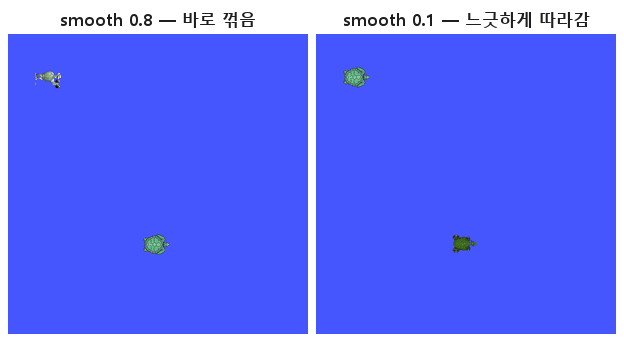

# gaze_object — 바라보고, 다가가고, 멈추는 거북이

ROS 2(Jazzy)를 학습하며 turtlesim에서 만든 rclpy 노드입니다.
움직이는 오브제가 사람을 **바라보고, 다가가고, 적당한 거리에서 멈추는** 동작을
실제 하드웨어로 옮기기 전에 시뮬레이션으로 먼저 구현해 보는 것이 목표입니다.

## 데모


같은 경로로 움직이는 turtle2(목표)를 turtle1이 `gaze_turtle`로 따라가는 모습입니다.
왼쪽은 `smooth:=0.8`(명령을 바로 따라감), 오른쪽은 `smooth:=0.1`(느긋하게 따라감)이며 나머지 조건은 같습니다.
turtle2는 비교를 위해 `scripts/demo_mover.py`로 매번 같은 S자 경로를 돌게 했습니다.

## 노드
| 노드 | 하는 일 |
|---|---|
| `gaze_turtle` | turtle2를 계속 바라보며 다가가고, 거리에 따라 감속하다 가까워지면 멈춤 |
| `smooth_turtle` | 숨 쉬듯 빨라졌다 느려지는 S자 주행 (부드러운 움직임 연습) |

## gaze_turtle 동작 원리
20Hz 타이머(`tick`)마다 아래 순서로 계산합니다.

1. **방향**: `atan2(dy, dx)`로 turtle2가 있는 방향을 구하고, 현재 방향과의 차이를 `wrap()`으로 -π~π 범위에 맞춤
   (wrap이 없으면 179°→-179°처럼 경계를 넘을 때 거의 한 바퀴를 거꾸로 돎)
2. **회전 명령**: 각도 오차에 비례(`gain`)해 회전 속도를 정하고 `max_speed`로 제한
3. **부드럽게**: 명령을 바로 바꾸지 않고 `smooth` 비율만큼만 따라가게 해서 급하게 꺾이지 않도록 함
4. **거리에 따른 속도**: `hypot(dx, dy)`로 거리를 구해 전진 속도를 결정

| 거리 | 전진 속도 |
|---|---|
| 1.0 미만 | 0 (정지) |
| 1.0 ~ 2.0 | `(dist - 1.0) * 2.0` (0에서 2.0까지 서서히) |
| 2.0 이상 | 2.0 (최대) |

경계(1.0, 2.0)에서 속도가 끊기지 않고 이어지도록 식을 맞췄습니다.
처음에는 기울기를 1.5로 두어 2.0 지점에서 속도가 1.5→2.0으로 튀었는데, 이를 고쳐 연속이 되게 했습니다.

## 실행 방법
```bash
# 빌드
cd ~/ros2_ws && colcon build --symlink-install --packages-select gaze_object
source install/setup.bash

# 터미널 1: 시뮬레이터
ros2 run turtlesim turtlesim_node

# 터미널 2: 바라볼 대상(turtle2) 생성 후 키보드로 조종
ros2 service call /spawn turtlesim/srv/Spawn "{x: 2.0, y: 2.0, theta: 0.0, name: 'turtle2'}"
ros2 run turtlesim turtle_teleop_key --ros-args -r /turtle1/cmd_vel:=/turtle2/cmd_vel

# 터미널 3: 노드 실행
ros2 run gaze_object gaze_turtle
```

파라미터 예시: `ros2 run gaze_object gaze_turtle --ros-args -p gain:=2.0 -p smooth:=0.1`

| 파라미터 | 기본값 | 의미 |
|---|---|---|
| `gain` | 3.0 | 얼마나 세게 돌아볼지 |
| `max_speed` | 3.0 | 최대 회전 속도 |
| `smooth` | 0.15 | 0~1, 작을수록 느긋하게 반응 |

## 다음 단계 (계획)
- turtle2의 위치 대신 카메라로 인식한 사람의 위치를 입력으로 사용
- 회전 명령을 서보 각도로 옮겨, 사람과 눈을 맞추는 작은 오브제로 확장

## 환경
Ubuntu 24.04 (WSL2) · ROS 2 Jazzy · Python (rclpy)
